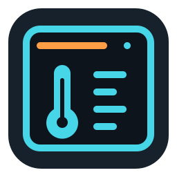

# THERMALRIGHT DIGITAL for Unraid

[Français](README.fr.md) · [Releases](https://github.com/MrPatates/thermalright-digital-unraid/releases) · [Report an issue](https://github.com/MrPatates/thermalright-digital-unraid/issues)

A community plugin that controls the USB display of a Thermalright Peerless Assassin 140 Digital from Unraid Settings. It provides an English interface, real host CPU metrics and a TRCC 9.11.2 driver in an isolated Docker container. It adds no global Python, pip, User Scripts or systemd installation to Unraid.

Version **2026.11.01.1**, licensed under **GPL-3.0-or-later**. Core functionality, including CPU watts and temperature colors by category, was confirmed by the user with version .7 on **Unraid 7.3.4**, USB **0416:8001**, **LF12** profile. Other accepted versions and layouts still need hardware validation. This release adds scheduled display off and a compact Docker instance name; see the [test report](docs/TEST-REPORT.md) for validation limits.

## Features

- CPU temperature from hwmon, load from `/proc/stat`, MHz from cpufreq and CPU power from hwmon or RAPL package energy counters.
- Static RGB, independent zone colors, temperature colors, breathing, rainbow, brightness and color smoothing.
- Choose which categories follow temperature: only the °C digits, or any combination of load, watts, MHz and decorations. Other categories keep their fixed colors.
- Weekly scheduled display off: chosen weekdays, overnight time windows or entire days, using the Unraid server timezone.
- An 8-second visual test, optional autostart after the array and Docker, and USB rediscovery by VID/PID.
- Installation and updates through GitHub releases, a complete offline bundle, persistent settings and rollback.
- Explicit cleanup of verified old plugin versions and a recognized legacy manual installation, preserving shared or unrelated resources.

## Install

In **Plugins → Install Plugin**, enter:

```text
https://github.com/MrPatates/thermalright-digital-unraid/releases/latest/download/thermalright-digital.plg
```

Use a published stable release; draft assets are inaccessible to Unraid. Versioned downloads are verified using SHA-256. An identical existing image is reused, and subsequent server boots can work offline.

Open **Settings → THERMALRIGHT DIGITAL**, select the CPU sensor and click **Start** while the array and Docker are running. Autostart is disabled by default. After updating, reload with **Ctrl+F5**. Settings are retained. Check for public updates in the Plugins tab.

The plugin accepts stable x86_64 Unraid **6.12.x and 7.0.x–7.3.x**. Other versions and prereleases are refused; this compatibility guard does not certify every accepted version.

### Offline installation

Download the complete release ZIP, verify `SHA256SUMS`, then copy the **entire `thermalright-digital` directory** to `/boot/config/plugins/`. Select this file in the Unraid plugin installer:

```text
/boot/config/plugins/thermalright-digital/packages/2026.11.01.1/thermalright-digital.plg
```

Or run:

```bash
plugin install /boot/config/plugins/thermalright-digital/packages/2026.11.01.1/thermalright-digital.plg
```

Allow about 85 MiB on the boot flash and 250 MiB in Docker storage. The plugin creates no appdata, Docker volume or private network.

## Settings and readings

Under **Display colors**, select **CPU temperature colors**, then **Temperature only**. Digits such as **42 °C** will follow the palette while W/MHz/% keep their fixed category colors. Configure thresholds, four palette colors and smoothing. Smoothing affects colors only; digits show actual readings. Effects update the USB display live. Motherboard and fan ARGB are controlled separately by their own hardware.

Unavailable readings remain `null` in status and their display digits/units are switched off. A genuine zero remains displayable. W/MHz capabilities are reported after the handshake: LF8/LF12/LF15 support both, while AK120 supports watts. Values exceeding the available digits are hidden.

Frequency uses the maximum of unique active cpufreq policies, or their arithmetic mean without weighting by core count. The `scaling_cur_freq` fallback is labeled **driver-requested frequency** and may differ from physical frequency.

Watts refer to the selected CPU source, not total power at the wall. RAPL uses package energy deltas and monotonic time; subdomains and duplicate providers are not added together. The first sample, an unreadable counter or an invalid delta remains unavailable. `enabled=0` describes RAPL power-limit controls and does not invalidate a readable energy counter. Individual CPU rails can be selected explicitly by label. Power is never estimated from TDP or load. GPU metrics are not provided.

Animations run at 10 Hz. The 1–60 second interval controls small-display alternation. The color/segment test shows synthetic digits for 8 seconds, keeps real readings in status and automatically returns to normal.

The plugin and backend share an original screen/thermometer icon. The Docker instance is named **TR-DIGITAL** so its name fits beside the icon. Upgrades remove owned older lowercase or long uppercase instances through the existing ownership labels. Persistent paths and plugin IDs remain compatible with earlier versions.

### Scheduled display off

Enable **Scheduled display off**, select weekdays and set **Turn off at** / **Turn back on at**, then click **Save**. The schedule is disabled by default. Select every day for a daily interval; choose **Keep display off for the entire selected days** for weekday-only control.

Days identify when an off period starts. For example, selecting Monday with 23:00–07:00 switches off Monday night and wakes Tuesday at 07:00. Entire days run from midnight to midnight. Timed intervals include their start and exclude their end; equal times are rejected unless entire-day mode is selected.

The displayed server clock/timezone is authoritative, including daylight saving changes. All display LEDs, digits and decorations are blanked with the controller's global display switch off. The backend, USB connection and real CPU readings remain active. Output resumes automatically on the next host sample, normally within one second, without restarting the container. Scheduled off overrides visual tests; a running test is canceled and a new test is refused during that period. Disable the schedule and save to restore output early. These controls affect the USB display, not motherboard/fan ARGB.

## Update, uninstall and troubleshooting

Updates stage code in RAM, verify packages and preserve settings/inventory. If a previously active backend fails to become ready, the old code is restored. Older packages allow explicit rollback with **Force Install**. Run only one driver against the display at a time.

To uninstall, use **Plugins → Remove** with Docker available, or `plugin remove thermalright-digital.plg`. Verified private resources are removed; shared or pre-existing resources are preserved. If Docker is unavailable, inventory is retained and removal must be retried. See [cleanup](docs/CLEANUP.md), [Unraid validation](docs/VALIDATION-UNRAID.md) and the [test report](docs/TEST-REPORT.md).

Export diagnostics from the settings page when reporting a problem. Remove private paths, identifiers and tokens before attaching them to an issue.

## Development and Community Applications

```bash
python3 scripts/fetch-dependencies.py
CONTAINER_ENGINE=podman bash scripts/build.sh
# Or: CONTAINER_ENGINE=docker bash scripts/build.sh
```

See [CONTRIBUTING.md](CONTRIBUTING.md) for prerequisites and tests. The build verifies dependencies, runs the suites, exports a real Docker archive and produces an offline ZIP, complete source package and `dist/release/`. Generated files are ignored by Git.

[GitHub publication](docs/GITHUB-PUBLICATION.md) describes release publishing. Workflows create **draft releases**; publishing them is an explicit GitHub action.

This repository includes `ca_profile.xml`, the [plugin wrapper](plugins/thermalright-digital.xml) and a dedicated icon for Community Applications submission. These files prepare the project for review; they do not mean the plugin is already listed. See the [submission guide](docs/COMMUNITY-APPLICATIONS.md).

The source package includes plugin and third-party sources. See [architecture](docs/ARCHITECTURE.md), [licenses](licenses/THIRD-PARTY-NOTICES.md) and [changelog](CHANGELOG.md). This project is not affiliated with Thermalright, Unraid or TRCC. The [French README](README.fr.md) preserves the documentation from release .8.
